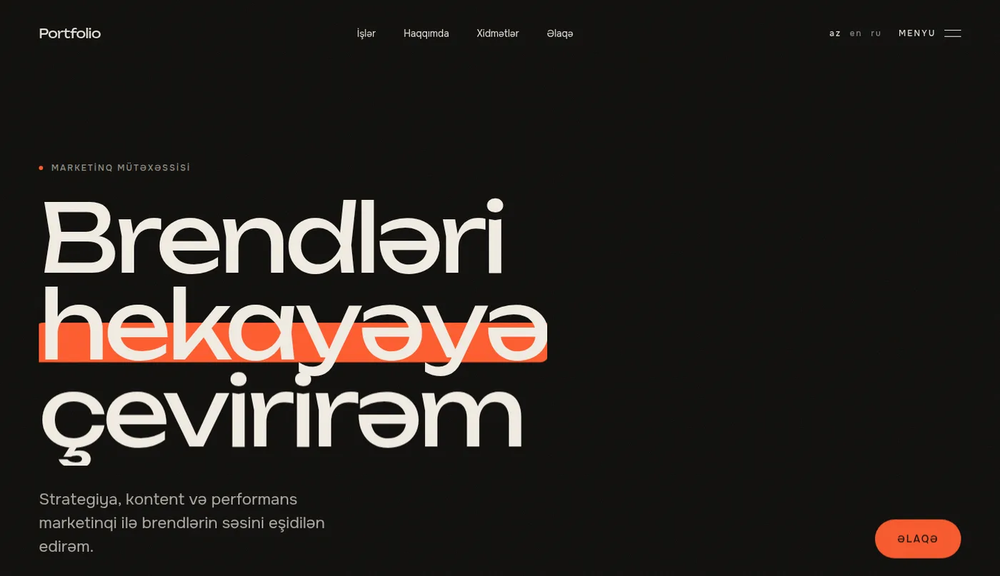
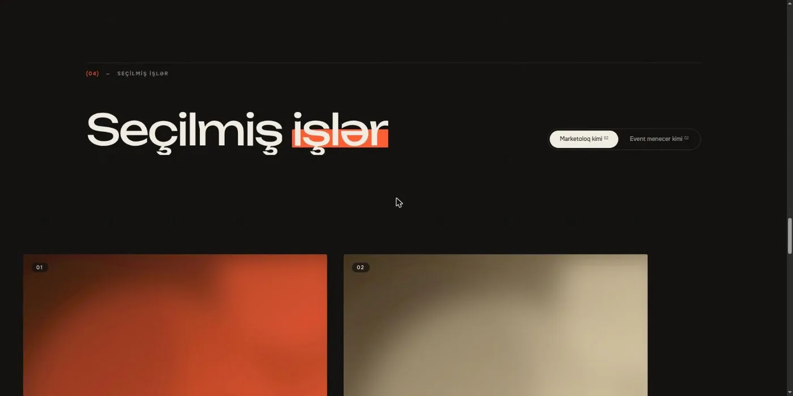
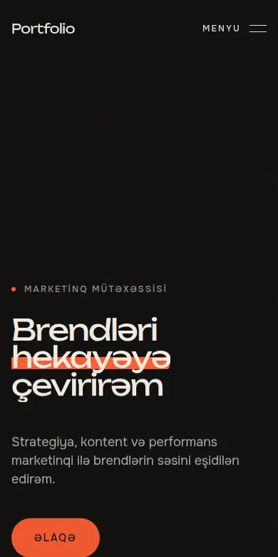
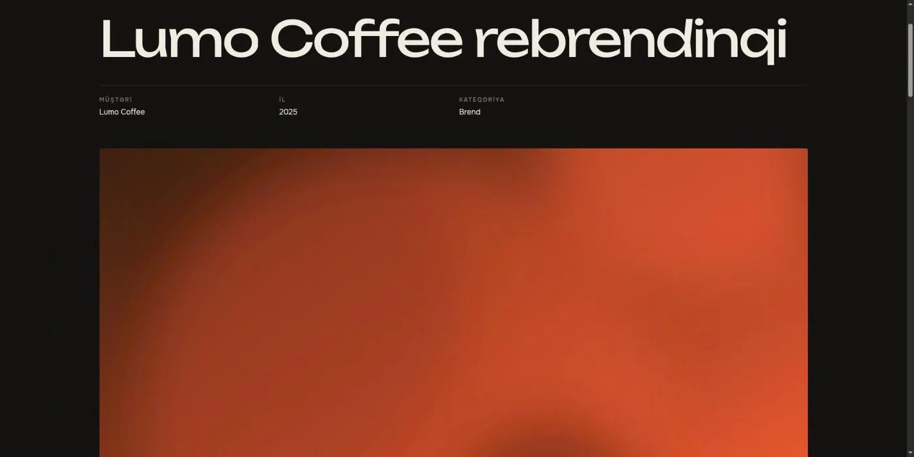
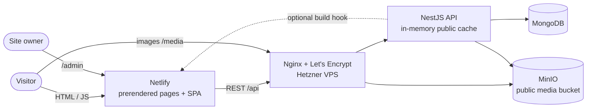

<div align="center">

# Marketing Portfolio

**An animated, editorial portfolio site for a marketing professional — with its own admin panel.**

Every word, image, case study and section on the site is managed from a small admin panel, in three languages (AZ / EN / RU). The public site is built for feel: kinetic typography, scroll-driven motion, page transitions and a shared-element case-study reveal — on a strict performance and accessibility budget.

[](https://react.dev/)
[](https://www.typescriptlang.org/)
[](https://vitejs.dev/)
[](https://tailwindcss.com/)
[](https://motion.dev/)
[](https://gsap.com/)
<br/>
[](https://nestjs.com/)
[](https://www.mongodb.com/)
[](https://min.io/)
[](https://www.docker.com/)
[](https://sheyla-portfolio.netlify.app)

### 🌐 [sheyla-portfolio.netlify.app](https://sheyla-portfolio.netlify.app)

</div>

<p align="center">
  
</p>

---

## Table of Contents

- [Live Site](#live-site)
- [Screenshots](#screenshots)
- [Features](#features)
- [Tech Stack](#tech-stack)
- [Architecture](#architecture)
- [Engineering Highlights](#engineering-highlights)
- [Project Structure](#project-structure)
- [Getting Started](#getting-started)
- [Testing & Quality](#testing--quality)
- [Deployment](#deployment)
- [Author](#author)

---

## Live Site

|                 | URL                                                                                                                                                                                   |
| --------------- | ------------------------------------------------------------------------------------------------------------------------------------------------------------------------------------- |
| **Public site** | **[sheyla-portfolio.netlify.app](https://sheyla-portfolio.netlify.app)** — also [`/en`](https://sheyla-portfolio.netlify.app/en) and [`/ru`](https://sheyla-portfolio.netlify.app/ru) |
| Admin panel     | [sheyla-portfolio.netlify.app/admin](https://sheyla-portfolio.netlify.app/admin) (private, single admin)                                                                              |
| API             | [sheila-portfolio.duckdns.org/api/health](https://sheila-portfolio.duckdns.org/api/health)                                                                                            |

> The site currently shows **demo content** (fictional brands and generated artwork) until the owner replaces it with real work from the admin panel.

---

## Screenshots

<table>
  <tr>
    <td width="68%"></td>
    <td rowspan="2" width="32%"></td>
  </tr>
  <tr>
    <td></td>
  </tr>
</table>

---

## Features

### Public site

- **One-page home** — Hero, Clients, About (bio, animated stats, experience & education timelines), Services, Work, Testimonials, Contact. The owner can reorder sections, hide any of them, or hide just the experience/education block.
- **Work in two groups** — case studies are split into two tabs (e.g. _"As a marketer"_ / _"As an event manager"_) with admin-defined titles; the tab is remembered when coming back from a case study, and "next project" stays within the group.
- **Case study pages** — challenge / solution (rich text), animated results, gallery with a keyboard-friendly lightbox. The card's cover **grows into the case-study hero** (FLIP shared-element transition).
- **Motion** — split-text headline reveals with a signature _marker highlight_ (`*word*` in any heading), scroll-scrubbed parallax, a pinned horizontal work rail on desktop, magnetic buttons, a custom cursor, page-transition curtains, a first-visit preloader, Lenis smooth scrolling.
- **Three languages** — `/` (AZ, default), `/en`, `/ru`; the visitor's choice is remembered.
- **Contact form** with honeypot + minimum fill time spam protection; messages land in the admin.

### Admin panel (`/admin`)

- Ant Design 6, Azerbaijani UI, loaded as a separate chunk — never part of the public bundle.
- Every text field is edited in AZ / EN / RU tabs, with warnings for missing translations.
- Drag-and-drop ordering for case studies, services, clients, testimonials and home sections.
- Media library with uploads to S3 (MinIO), automatic WebP variants + blur placeholders, mandatory alt text, and "in use" protection against deleting referenced files.
- Site settings: name, logo, favicon, colors (live theme), fonts, socials, contact info, SEO texts and OG image, feature toggles (cursor, preloader, smooth scroll).
- Unsaved-changes guard, "view on site" shortcuts, message inbox with unread badge.

---

## Tech Stack

| Area         | Choices                                                                                                                            |
| ------------ | ---------------------------------------------------------------------------------------------------------------------------------- |
| **Frontend** | React 19, Vite 8, TypeScript 7, Tailwind CSS 4 (CSS-variable tokens), React Router 8, RTK Query, react-i18next                     |
| **Motion**   | Motion 14 (`LazyMotion` + `m.*`), GSAP + ScrollTrigger (lazy), Lenis                                                               |
| **Admin**    | Ant Design 6, dnd-kit, separate Redux store                                                                                        |
| **Backend**  | NestJS 12 (ESM), Mongoose 9 / MongoDB 7, MinIO (S3) + sharp, JWT + argon2, zod env validation, class-validator DTOs, Swagger (dev) |
| **Infra**    | Docker Compose on a Hetzner VPS behind Nginx + Let's Encrypt; Netlify for the site                                                 |
| **Tooling**  | oxlint, Prettier, Vitest (unit + e2e against real MongoDB/MinIO)                                                                   |

---

## Architecture



- **Public endpoints** return only published items, sorted by the admin's order, and are cached in memory. Every admin write invalidates the related cache keys, so changes are visible on the next page load.
- **Singletons** (settings, hero, about) and **ordered collections** (projects, services, clients, testimonials) share one generic `OrderedCrudService` (CRUD, reorder, cached published lists).
- **One bootstrap request** (`/api/public/bootstrap`) delivers settings, hero, about and the enabled sections, so the first paint needs a single API call.

---

## Engineering Highlights

### 1. A performance budget for an animation-heavy site

- Initial public JS is **~85 KB gzip**: Motion runs through `LazyMotion` (features loaded async), GSAP/ScrollTrigger and Lenis load **when the browser is idle**, and every home section below the fold is its own lazy chunk. Number tweens use a tiny rAF helper instead of Motion's `animate()`.
- Only `transform` / `opacity` are animated; the LCP image loads eagerly without a fade, and `srcset` always includes the original so phones never get a soft 480 px image.
- Lighthouse (production build): **Accessibility 100 · Best Practices 100 · SEO 100**, desktop performance 97, CLS ≈ 0.

### 2. SEO for a client-rendered SPA — without SSR

`lib/seo.ts` computes title, description, canonical, `hreflang` (az/en/ru + x-default), Open Graph / Twitter tags and JSON-LD (`Person`, `CreativeWork`). The **same pure module** runs in two places:

- in the browser, via `useSeo()`, on every route change;
- at build time, in `scripts/prerender.ts` — executed directly by Node's built-in TypeScript type stripping — which writes a static HTML file per route and language (`/`, `/en`, `/work/<slug>`, …) with the final `<head>`, crawler text, resource hints (API preconnect, bootstrap + LCP image preload), plus `sitemap.xml` and `robots.txt`.

Social previews and crawlers get real metadata; visitors get the full SPA.

### 3. Accessibility & reduced motion

- `prefers-reduced-motion` turns off the preloader, custom cursor, cursor glow, parallax and smooth scroll; a global `MotionConfig` skips transform animations app-wide.
- Split-text headings keep the full sentence in `aria-label`; counters expose the final value to screen readers; skip-to-content link; the full-screen menu is a focus-managed dialog; 44 px touch targets; contrast-checked tokens.

### 4. A content model the owner can't break

- Every translatable field is a `LocalizedString { az, en, ru }` with fallback to the default language.
- Admin-written rich text renders through a small Markdown-to-React renderer — no HTML injection anywhere.
- Media references are validated (type-checked) and tracked, so a file in use can't be deleted.
- "Remove this section" requests are implemented as **switches, never deletions** — the owner can bring anything back.

### 5. Design system "Signal"

Warm black, cream and a single signal-orange accent; editorial numbered sections; fonts verified to contain every Azerbaijani letter (Ə, Ğ, İ, Ş…) and Cyrillic. Colors and fonts are CSS variables, so the admin can re-theme the live site. See [`docs/design/DIRECTION.md`](docs/design/DIRECTION.md).

---

## Project Structure

```
client/                 React app (public site + admin)
  src/
    components/         sections/, motion/, layout/, ui/, admin/
    pages/              site/ (home, case study, 404), admin/ (lazy chunk)
    lib/                seo, markdown, media, lenis, gsap, tween, icons …
    api/                RTK Query: publicApi (site) / adminApi (admin)
    i18n/               az.json, en.json, ru.json
  scripts/prerender.ts  build-time prerender + sitemap
server/                 NestJS API
  src/modules/          settings, hero, about, projects, services, clients,
                        testimonials, contact, media, auth, stats, public
  src/common/           ordered CRUD base, public cache, build hook, DTOs
  test/                 e2e suites (real MongoDB + MinIO)
deploy/                 production compose, nginx site, backup/update scripts
docs/                   SPEC.md, DEPLOY.md, design direction, screenshots
netlify.toml            Netlify build config
```

---

## Getting Started

**Requirements:** Node 24, Docker.

```bash
# 1. Local MongoDB + MinIO
docker compose -f deploy/docker-compose.dev.yml up -d

# 2. API  →  http://localhost:3000/api  (Swagger: /api/docs)
cd server
cp .env.example .env        # set ADMIN_EMAIL / ADMIN_PASSWORD
npm install
npm run seed                # admin user + default settings
npm run seed:demo           # optional: demo content with generated images
npm run start:dev

# 3. Site  →  http://localhost:5173  (admin: /admin)
cd ../client
cp .env.example .env
npm install
npm run dev
```

`npm run build` in `client/` also runs the prerender, so it needs the API to be reachable.

---

## Testing & Quality

```bash
cd server && npm test             # unit tests
cd server && npm run test:e2e     # e2e: 57 tests across 8 suites, real MongoDB + MinIO
cd client && npm run lint         # oxlint (same in server/)
```

The e2e suites cover auth, settings validation, media uploads (type/size/alt rules, in-use protection), every content module, ordering, cache invalidation, project groups and the contact form's spam protection.

---

## Deployment

A zero-cost setup apart from the VPS:

- **Site** — Netlify (free subdomain), built from `main` on every push; `netlify.toml` pins Node 24 and fails the build if the prerender can't reach the API.
- **Backend** — Docker Compose on a Hetzner VPS (API, MongoDB, MinIO), shared with another project; host Nginx terminates TLS (Let's Encrypt via certbot) for a free DuckDNS domain and routes `/api` and `/media`.
- **Backups** — nightly `mongodump` + media volume archive, 14-day retention.

Step-by-step guide: [`docs/DEPLOY.md`](docs/DEPLOY.md).

---

## Author

**Anar Talibov** — [github.com/AnarDevJourney](https://github.com/AnarDevJourney)
